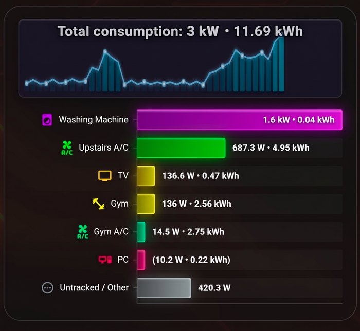

# ⚡ Realtime Power Card for Home Assistant (`v1.0.3`)

An advanced Lovelace card for **Home Assistant** that visualizes real-time power consumption (**W / kW**) and daily energy usage (**kWh**) directly synced with your **Energy Dashboard**.

  

> 💡 **First Step / Prerequisite:** To unlock the full potential of this card (automatic device discovery, automatic pairing of `kWh` energy sensors with `W`/`kW` power sensors, daily `kWh` summaries, and parent-child circuit hierarchy), it is highly recommended to **configure your Home Assistant Energy Dashboard first** (*Settings -> Dashboards -> Energy*) if you haven't done so already.

---

## ✨ Features (`v1.0.3`)

* **🔄 Auto-Sync with Energy Dashboard:** Automatically fetches devices configured in the HA Energy Dashboard, pairs energy entities (`kWh`) with their corresponding power sensors (`W`/`kW`), and maps parent-child hierarchy (`included_in_stat`).
* **🧊 High-Gloss 3D Acrylic Prism Bars:** Bars are rendered as seamless, glossy 3D cuboids featuring sharp diagonal glass reflections, bright inner specular ridges, realistic face shading, and neon floor reflection glow.
* **📊 Header History Chart:**
  * **Time Range Modes:**
    * **`today` (Start of Day 00:00 - 24:00):** The chart starts at midnight and fills dynamically as the day progresses. Future hours remain unlit.
    * **`rolling` (Last X hours):** A sliding time window (1 - 168 hours).
  * **4 Visual Styles:** *Segmented LED Equalizer*, *Combo (Bars + Line & Nodes)*, *Smooth Area Line*, and *Classic Columns*.
* **📈 5 Main Chart Types:**
  1. **Horizontal Bar Chart (`bar`)** – features smooth sorting animations.
  2. **Pie Chart (`pie`)** – true circular rendering with glossy sheen and device icons inside slices.
  3. **Donut Chart (`donut`)** – shows the total power and daily kWh in the center.
  4. **Horizontal Sankey Flow (`sankey_h`)** – multi-level tree: *Grid -> Main Circuits -> Sub-devices*.
  5. **Vertical Sankey Flow (`sankey_v`)**.
* **🎨 Unified Top-Layer Spectrum Color Picker:** A custom-built modal using native `<dialog>.showModal()` to render in the browser's `#top-layer` above Home Assistant's configuration dialogs across both desktop and mobile devices.
* **🌍 Regional Formatting & Units:** Automatically converts units to `kW` above `1000 W` and applies regional number formatting (e.g., `1,95 kW • 12,13 kWh` vs `1.95 kW • 12.13 kWh`).

---

## 📦 Installation

### Step 0: Configure Home Assistant Energy Dashboard (Recommended)
Before adding the card, make sure your grid consumption and individual devices are added to the built-in **Home Assistant Energy Dashboard** (*Settings -> Dashboards -> Energy*). While you can still add devices manually in the card editor, configuring the Energy Dashboard first allows the card to automatically configure all entities, icons, daily `kWh` counters, and circuit hierarchies out of the box.

### HACS (Recommended)
1. Open **HACS** in Home Assistant -> **Frontend**.
2. Click the menu in the top right corner (⋮) -> **Custom repositories**.
3. Paste the URL: `https://github.com/HavenFlow/realtime-power-card` and select **Dashboard (Lovelace)** as the category.
4. Install **Realtime Power Card** and refresh your browser.

### Manual Installation
1. Download `realtime-power-card.js` from the [Releases](https://github.com/HavenFlow/realtime-power-card/releases) page.
2. Copy it into your `/config/www/` directory.
3. Go to **Settings -> Dashboards -> Resources** and add:
   * URL: `/local/realtime-power-card.js?v=1.0.3`
   * Type: `JavaScript Module`

---

## ⚙️ Configuration (Visual GUI Editor)

This card includes a 100% complete visual editor. Just add the card to your dashboard and your Energy Panel devices will be loaded automatically:

    type: custom:realtime-power-card
    chart_type: bar
    bar_style: 3d
    header_history_enable: true
    header_history_mode: today
    header_history_type: led
    show_daily_kwh_devices: true
    show_daily_kwh_total: true
    unit_kw_above_1kw: true

---

## 🔧 Core YAML Parameters

| Parameter | Type | Default | Description |
| :--- | :--- | :--- | :--- |
| `chart_type` | `string` | `'bar'` | `'bar'`, `'pie'`, `'donut'`, `'sankey_h'`, `'sankey_v'` |
| `total_power_entity` | `string` | `""` | Total house power entity (empty = auto from Energy Panel) |
| `hierarchy_mode` | `string` | `'brackets'` | Sub-device handling: `'brackets'` (show in brackets), `'subtract'` (deduct from parent), `'hide'` (hide completely) |
| `header_history_enable` | `boolean` | `true` | Enables the background history chart in the header |
| `header_history_mode` | `string` | `'today'` | `'today'` (from 00:00, live fill) or `'rolling'` (last X hours) |
| `header_history_type` | `string` | `'combo'` | `'led'`, `'combo'`, `'line'`, `'bar'` |
| `bar_style` | `string` | `'3d'` | `'3d'` (glossy 3D prism), `'gradient'`, `'glass'`, `'flat'` |
| `bar_3d_depth` | `number` | `10` | 3D depth in pixels for the prism effect (`4-24`) |
